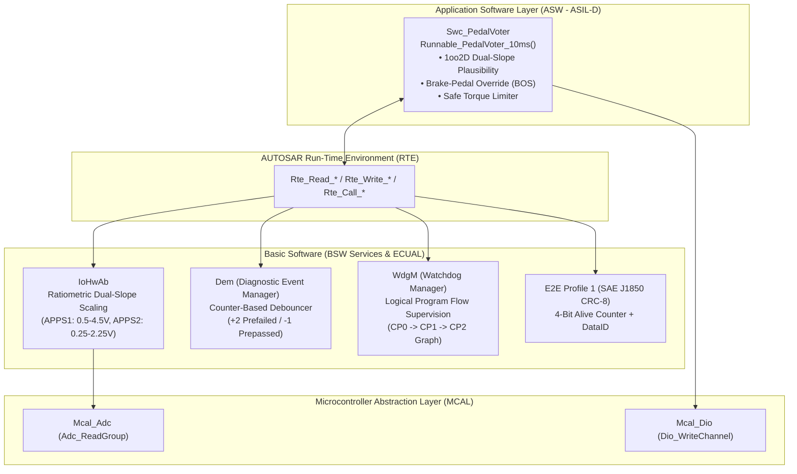

# AUTOSAR Classic ASIL-D Redundant Pedal Voter & E2E Stack (`autosar-classic-bsw-rte-pedal-voter`)

[](https://github.com/Yigitcakirdogan/autosar-classic-bsw-rte-pedal-voter/actions/workflows/ci.yml)

-critical?style=flat-square)


A turnkey **AUTOSAR Classic layered architecture** and **ISO 26262 ASIL-D Functional Safety** reference implementation for an automotive **Vehicle Control Unit (VCU) Dual-Channel Accelerator Pedal Position Sensor (APPS) Plausibility Voter & E2E-Protected Torque Request Transmitter**, written in strict **MISRA C:2012** compliant C.

---

## ISO 26262 Safety Concept & ASIL-D Architecture

- **Hazard Identification (HARA):** Unintended vehicle acceleration caused by sensor drift, short-to-battery, open-circuit ground loss, or corrupted CAN torque request frames.
- **Safety Goal (`SG-01`):** Prevent positive propulsion torque request when pedal sensors disagree by $> 5.0\%$ ($50\text{ ‰}$) or when any sensor electrical fault occurs (**ASIL-D**, **FTTI = 50 ms**).
- **Safe State:** Immediate transition to **Safe Torque Off (`0 Nm`)**, assertion of Fault Indicator Lamp (`DIO_CH_MIL_LAMP = STD_HIGH`), and storage of confirmed Diagnostic Trouble Code (`DTC 0xP2138`) in `Dem`.



---

## Technical Highlights

1. **Dual-Slope Redundant Sensor Conditioning (`IoHwAb`):**
   - Automotive pedals use two physically independent Hall-effect sensors with a **2:1 voltage ratio** (`APPS1: 500–4500 mV`, `APPS2: 250–2250 mV`) so a common-mode power supply drop or cross-wire short between channels is immediately detected as a slope divergence.
   - Out-of-bounds electrical checks detect **Short-to-Ground (`< 400 mV`)** and **Short-to-Supply (`> 4600 mV`)** within a single `10 ms` tick.
2. **ISO 26262 Counter-Based Fault Debouncing (`Dem`):**
   - Implements AUTOSAR `Dem_SetEventStatus()` with asymmetric counter debouncing (`+2` on `DEM_EVENT_STATUS_PREFAILED`, `-1` on `DEM_EVENT_STATUS_PREPASSED`, confirmation threshold = `+6` / `30 ms` < `50 ms FTTI`).
3. **AUTOSAR End-to-End Protection (`E2E_P01`):**
   - Protects the outgoing 8-byte CAN Torque Request PDU using **SAE J1850 CRC-8 (`0x1D` polynomial)**, a **4-bit monotonic Alive Counter**, and a **16-bit implicit Data ID** to detect frame repetition, loss, insertion, or bit corruption.
4. **Watchdog Manager Logical Supervision (`WdgM`):**
   - Verifies that `Runnable_PedalVoter_10ms()` traverses checkpoints `CP_0_INPUT_ACQUIRE -> CP_1_SAFETY_VOTE -> CP_2_E2E_TX` in strict deterministic order before permitting hardware watchdog refresh.
5. **MISRA C:2012 Adherence:**
   - Fixed-width AUTOSAR types (`uint8`, `uint16`, `uint32`, `sint16`, `boolean`), zero dynamic memory allocation (Rule 21.3), no recursion (Rule 17.2), explicit boolean comparisons (Rule 14.4), and defensive `NULL_PTR` checks on every BSW/RTE entry point.

---

## Build & Run Verification Suite

```bash
cmake -B build -DCMAKE_BUILD_TYPE=Debug
cmake --build build
ctest --test-dir build --output-on-failure
```

---

## License

Released under the [MIT License](LICENSE).
